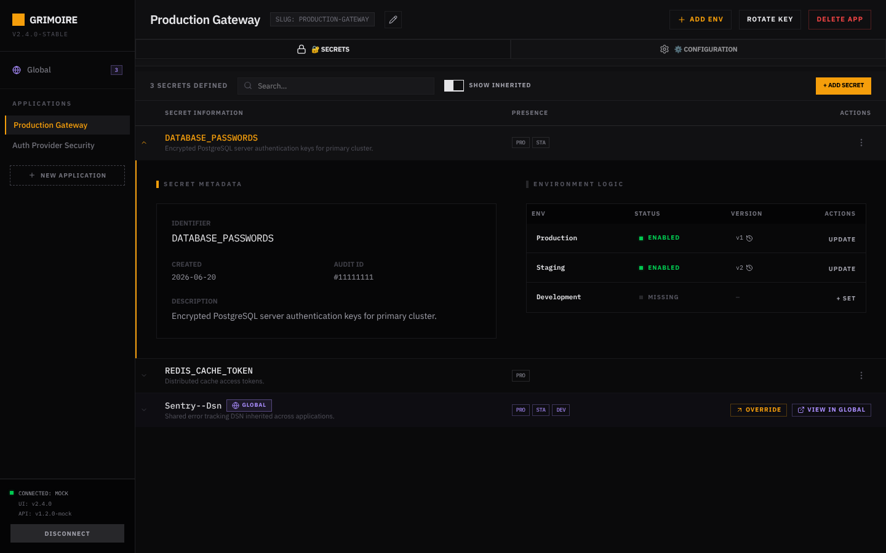
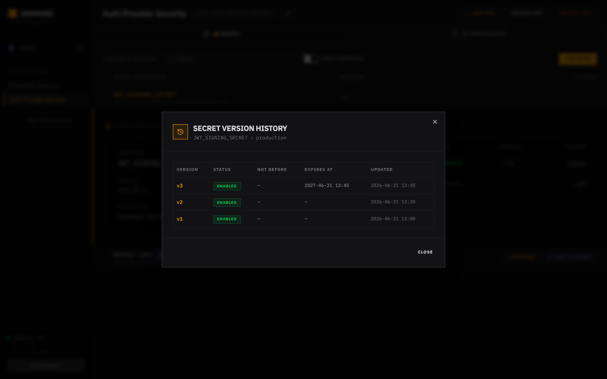
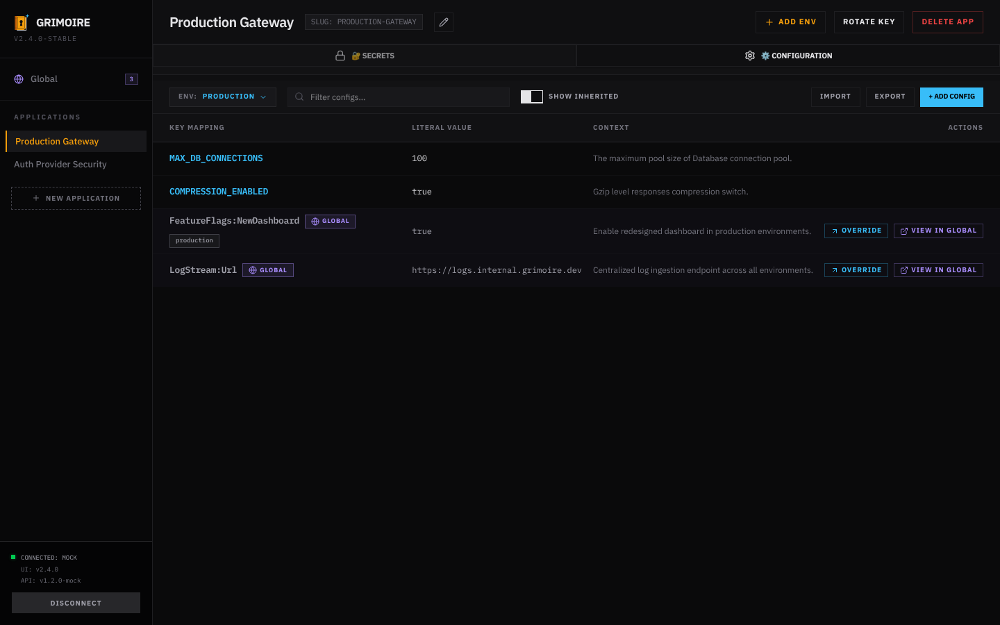
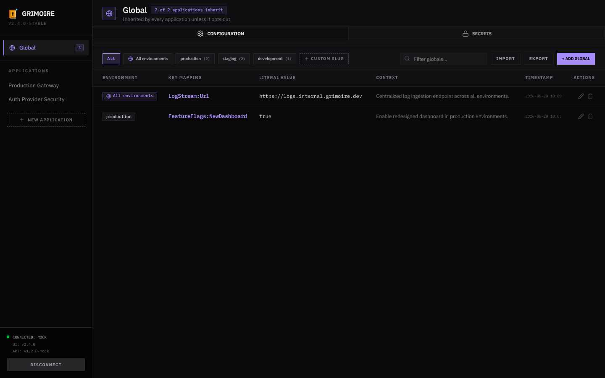
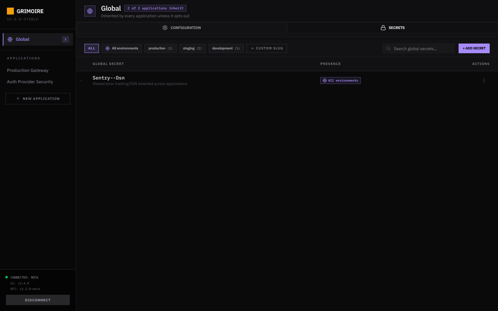
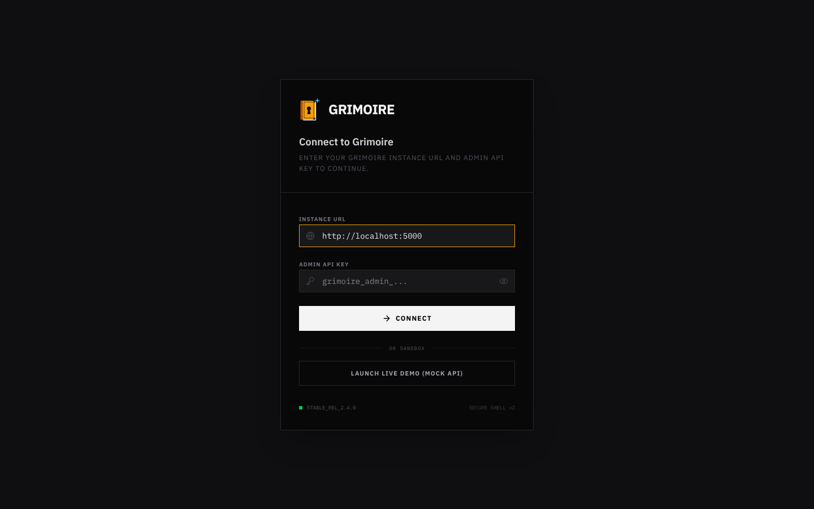
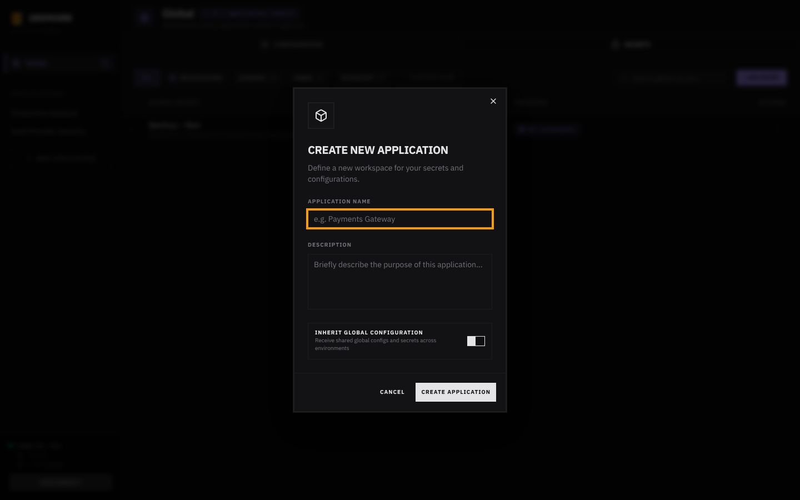

<p align="center">
  
</p>

# 🔮 Grimoire UI

[](https://github.com/guibranco/grimoire-ui/actions/workflows/build.yml)
[](https://github.com/guibranco/grimoire-ui/actions/workflows/deploy.yml)

> **The portal to your secrets.** A beautifully crafted, high-security management interface for Grimoire — your self-hosted secrets vault and configuration manager.

---

## ✨ Features

*   **🛡️ Secure Vaulting**: Manage sensitive credentials with an interface designed for security first.
*   **🌍 Environment Management**: Switch between Development, Staging, and Production contexts with zero friction.
*   **🔗 Deep Links**: Every application, environment, tab and Global entry has its own URL — bookmark it, share it, and use the browser's back/forward buttons.
*   **🧙‍♂️ Elegant UX**: A dark, magical aesthetic built with React 19, Tailwind CSS 4, and Framer Motion.
*   **🌑 Fluid Animations**: Powered by `motion` for smooth, meaningful transitions.
*   **📊 Insightful Dashboards**: Keep track of API keys, app configurations, and secret rotations.
*   **🚀 Modern Stack**: Fully typed with TypeScript, tested with Vitest, and built with Vite 6.

---

## 🖼️ Screenshots

> 🔮 **Try it yourself** — open the [live demo](http://guilherme.stracini.com.br/grimoire-ui/) and click **Launch Live Demo (Mock API)**. It runs entirely in your browser against a built-in mock API with demo data, so no Grimoire server is needed and nothing leaves your machine.

All screenshots below were captured from that same demo mode.

### 🔐 Application secrets
Per-application secrets with per-environment presence, status and versions. Secrets inherited from **Global** are flagged and can be overridden.



### 🕰️ Secret version history
Every value change creates a new version, with `Not Before` / `Expires At` support.



### ⚙️ Application configuration
Key-value configuration per environment, with import/export and inherited globals.



### 🌍 Global configuration & secrets
Shared values defined once and inherited by every application (unless it opts out), scoped to all environments or a specific one.

| Global configuration | Global secrets |
| :---: | :---: |
|  |  |

### 🔑 Connect & create
| Connect to an instance (or launch the demo) | Create an application |
| :---: | :---: |
|  |  |

<details>
<summary>📸 Regenerating the screenshots</summary>

The screenshots are produced by [`scripts/screenshots.mjs`](scripts/screenshots.mjs), which starts Vite, opens the app in headless Chromium, enters the mock demo and captures each view into `docs/screenshots/`:

```bash
npx playwright install chromium   # first run only
npm run screenshots
```

</details>

---

## 🛠️ Technology Spellbook

| Ingredient | Purpose |
| :--- | :--- |
| **React 19** | Modern UI components & state management |
| **Tailwind CSS 4** | Ultra-efficient utility-first styling |
| **Vite 6** | Lightning-fast build tool and dev server |
| **Vitest** | Blazing fast unit and integration testing |
| **Framer Motion** | Magical UI animations and interactions |
| **Zustand** | Lightweight, atomic state management |
| **Lucide React** | Beautifully simple icon set |

---

## 🚀 Quick Start

### 🧙‍♂️ Summoning the Project
Clone the repository and step into the circle:
```bash
git clone https://github.com/guibranco/grimoire-ui.git
cd grimoire-ui
```

### 🧪 Brew Dependencies
Install the necessary magical artifacts:
```bash
npm install
```

### ⚡ Stir the Cauldron (Dev Mode)
Launch the development portal:
```bash
npm run dev
```
Open [http://localhost:3000](http://localhost:3000) to see the magic happen.

---

## 📜 Available Rituals (Scripts)

*   `npm run dev` — Starts the development server at port 3000.
*   `npm run build` — Compiles the project into a production-ready `dist` folder.
*   `npm run test` — Runs the test suite in watch mode.
*   `npm run test:coverage` — Executes tests and generates a detailed coverage report.
*   `npm run lint` — Performs a thorough type-check with TypeScript.
*   `npm run clean` — Clears the `dist` directory.
*   `npm run screenshots` — Regenerates the README screenshots from the mock demo.

---

## 🧪 Testing Sanctuary

We take reliability seriously. Our testing suite ensures that your secrets stay safe and the UI stays consistent.

```bash
# Run tests
npm run test

# Run tests with coverage
npm run test:coverage
```

---

## 👷 Building for Production

To create a optimized production build, run:
```bash
npm run build
```
The artifacts will be generated in the `dist/` directory, ready to be hosted on your magical cloud.

---

## 🌌 Deployment

This project is configured for **GitHub Pages**. Every push to the `main` branch triggers a magical workflow that:
1.  🏗️ Builds the application.
2.  🧪 Runs all tests.
3.  🚀 Deploys to [http://guilherme.stracini.com.br/grimoire-ui/](http://guilherme.stracini.com.br/grimoire-ui/)
4.  🏷️ Creates a new SemVer release automatically.

### 🧭 Routes

| Path | View |
|---|---|
| `/` | Dashboard |
| `/apps/:appSlug` | Application, default environment |
| `/apps/:appSlug/:envSlug` | Application, given environment |
| `/apps/:appSlug/:envSlug/secrets` | Application secrets tab |
| `/global`, `/global/secrets` | Global configuration / secrets |
| `/global/config?key=KEY` | Global, with an entry highlighted |

GitHub Pages has no SPA fallback, so the deploy workflow copies `index.html` to `404.html`; deep links such as `/grimoire-ui/apps/my-app/production` then boot the client-side router.

---

## 🤝 Contribution

Feel like adding a new spell?
1.  Fork the repository.
2.  Create your feature branch (`git checkout -b feature/amazing-spell`).
3.  Commit your changes (`git commit -m 'Add some amazing spell'`).
4.  Push to the branch (`git push origin feature/amazing-spell`).
5.  Open a Pull Request.

---

## ⚖️ License

Distributed under the MIT License. See `LICENSE` for more information.

---

<p align="center">
  Built with ✨ and ☕ by <a href="https://github.com/guibranco">guibranco</a>
</p>
